<picture></picture>

Пишу бэкенд на Python: FastAPI, PostgreSQL, Celery, интеграции с LLM. Фронтенд делать не люблю, но иногда приходится.

Два лета работал в Strauss Group и написал там алгоритм, после которого доставка стала обходиться компании примерно на 30 млн ₽ в год дешевле. Параллельно беру заказы и езжу на кейс-чемпионаты. Учусь в НИЯУ МИФИ на бизнес-информатике.

**Стек.** Python, FastAPI, PostgreSQL, SQLAlchemy, Celery, Redis, Docker, TypeScript, Next.js.

**Контакты.** [Telegram](https://t.me/FlareAliZZZZe) и [vladfokin32376@gmail.com](mailto:vladfokin32376@gmail.com). Быстрее всего отвечу в Telegram.
